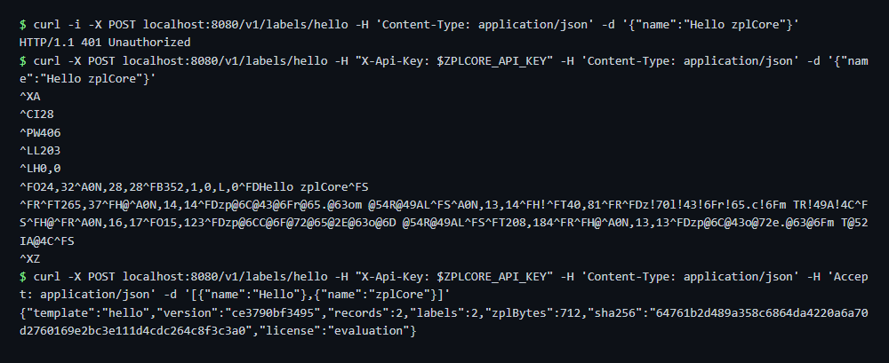

# Server and designer with API keys

The same setup as the [quickstart](../quickstart/), but every API call needs a key in the `X-Api-Key` header
(mode `apikey`). The keys come from a `.env` file next to `compose.yaml` that is never committed.

## Run

```sh
cd docker/api-key
cp .env.example .env        # put your own keys (at least 16 characters) into .env
docker compose up -d

export ZPLCORE_API_KEY=...  # the same value as in .env

# without a key: 401
curl -i -X POST localhost:8080/v1/labels/hello \
  -H 'Content-Type: application/json' -d '{"name":"Hello zplCore"}'

# with the key: ZPL
curl -X POST localhost:8080/v1/labels/hello -H "X-Api-Key: $ZPLCORE_API_KEY" \
  -H 'Content-Type: application/json' -d '{"name":"Hello zplCore"}'

# two records: JSON report (counts, size and SHA-256 of the ZPL, licence state)
curl -X POST localhost:8080/v1/labels/hello -H "X-Api-Key: $ZPLCORE_API_KEY" \
  -H 'Content-Type: application/json' -H 'Accept: application/json' \
  -d '[{"name":"Hello"},{"name":"zplCore"}]'
```

Generate a key, for example with `openssl rand -hex 24`. The designer UI stays public; its API needs
`ZPLCORE_DESIGNER_API_KEY` (see [embedding the designer](https://zplcore.com/docs/designer/)).
For single sign-on use mode `jwt`: [authentication](https://zplcore.com/docs/server/#auth).

## Expected output



The small `zplCore.com TRIAL` fields in the ZPL are the evaluation watermark: set `ZPLCORE_LICENSE_KEY` in `.env`
to use your licence key.
