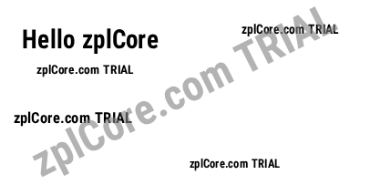
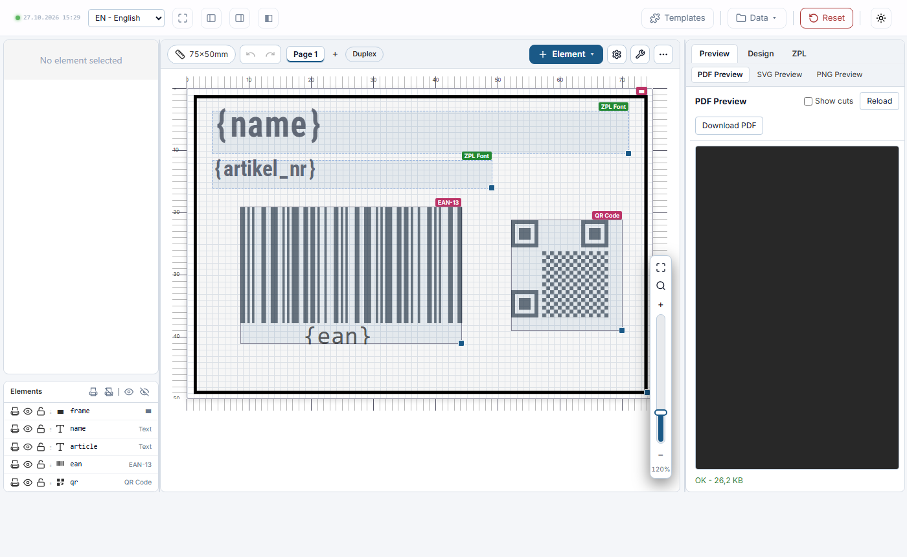
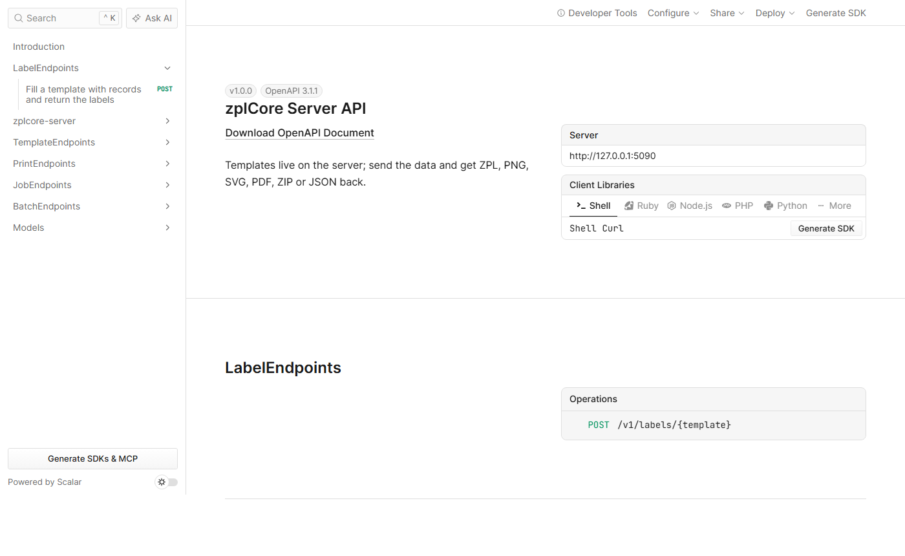

# Quickstart: server and designer

Starts zplCore Server (REST API: data in, labels out) and zplCore Designer (label editor in the browser) with one
`docker compose` command. Both run **without a login** – only for a local test. In production use API keys or JWT:
see the [api-key](../api-key/) sample and [authentication of the server](https://zplcore.com/docs/server/#auth).

## Run

```sh
cd docker/quickstart
docker compose up -d

# data in, ZPL out
curl -X POST localhost:8080/v1/labels/hello \
  -H 'Content-Type: application/json' -d '{"name":"Hello zplCore"}'

# the same label as PNG
curl -X POST localhost:8080/v1/labels/hello \
  -H 'Content-Type: application/json' -H 'Accept: image/png' \
  -d '{"name":"Hello zplCore"}' -o hello.png

docker compose down
```

- `templates/hello.json` is the label template, called as `/v1/labels/hello`.
- Designer: <http://localhost:8081/designer/>
- API reference of the server: <http://localhost:8080/docs>

## Expected output

`hello.png`:



The designer at <http://localhost:8081/designer/>:



The API reference at <http://localhost:8080/docs>:



Without a licence key both run in evaluation mode with a "zplCore.com TRIAL" watermark. Set `ZPLCORE__LICENSE__KEY`
(server) and `ZPLCORE_LICENSE` (designer) to use your key – see the [main README](../../README.md#licence-key).

More: [server documentation](https://zplcore.com/docs/server/) · [designer documentation](https://zplcore.com/docs/designer/)
