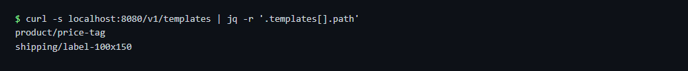
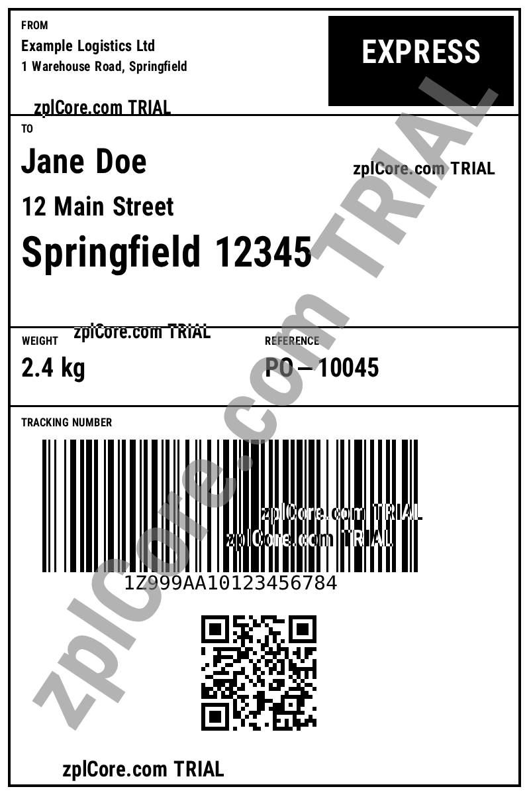

# Templates from a folder

zplCore Server reads the label templates from a folder mounted at `/templates`. The path below the folder is the
template name: `templates/shipping/label-100x150.json` is called as `shipping/label-100x150`. New and changed files
are picked up while the server runs (here every 5 seconds).

```text
templates/
  product/price-tag.json
  shipping/label-100x150.json
```

## Run

```sh
cd docker/templates-volume
docker compose up -d

# list the templates
curl -s localhost:8080/v1/templates | jq -r '.templates[].path'

# shipping label as PNG
curl -X POST localhost:8080/v1/labels/shipping/label-100x150 \
  -H 'Content-Type: application/json' -H 'Accept: image/png' -o shipping-label.png \
  -d '{"Service":"EXPRESS","Name":"Jane Doe","Street":"12 Main Street","City":"Springfield 12345","Weight":"2.4","Reference":"PO-10045","TrackingNo":"1Z999AA10123456784"}'

# two price tags as one PDF
curl -X POST localhost:8080/v1/labels/product/price-tag \
  -H 'Content-Type: application/json' -H 'Accept: application/pdf' -o price-tags.pdf \
  -d '[{"Name":"Water Bottle 750 ml","Price":24.9,"Ean":"4006381333931"},{"Name":"Lunch Box","Price":12.5,"Ean":"9506000134352"}]'
```

This sample runs without a login (`ZPLCORE__AUTH__MODE: none`) – only for a local test. In production use API keys
or JWT: [authentication of the server](https://zplcore.com/docs/server/#auth).

## Expected output



`shipping-label.png` and a price tag:

 

Other template sources (S3, Azure Blob Storage, Google Cloud Storage, HTTP, Git): see
[templates in the server documentation](https://zplcore.com/docs/server/).
