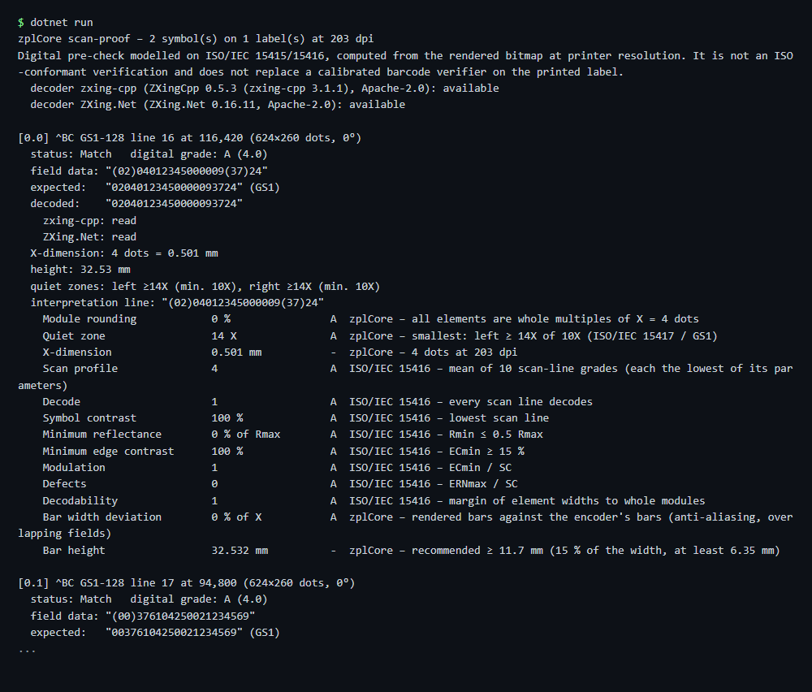

# Barcode scan-proof

Decodes every barcode of a ZPL label back from the rendered image with two independent decoders, compares the result with the field data and grades it A-F (modelled on ISO/IEC 15416/15415). A pre-check, not an ISO verification.

## Run

```sh
cd dotnet-csharp/barcode-scan-proof
dotnet run    # input: label.zpl
dotnet run -- my-label.zpl    # your own input
```

Results are written to the `output` folder.

## Expected output

```text
zplCore scan-proof – 2 symbol(s) on 1 label(s) at 203 dpi
Digital pre-check modelled on ISO/IEC 15415/15416, computed from the rendered bitmap at printer resolution. It is not an ISO-conformant verification and does not replace a calibrated barcode verifier on the printed label.
  decoder zxing-cpp (ZXingCpp 0.5.3 (zxing-cpp 3.1.1), Apache-2.0): available
  decoder ZXing.Net (ZXing.Net 0.16.11, Apache-2.0): available

[0.0] ^BC GS1-128 line 16 at 116,420 (624×260 dots, 0°)
  status: Match   digital grade: A (4.0)
  field data: "(02)04012345000009(37)24"
  expected:   "02040123450000093724" (GS1)
  decoded:    "02040123450000093724"
    zxing-cpp: read
    ZXing.Net: read
  X-dimension: 4 dots = 0.501 mm
  height: 32.53 mm
  quiet zones: left ≥14X (min. 10X), right ≥14X (min. 10X)
  interpretation line: "(02)04012345000009(37)24"
    Module rounding            0 %                A  zplCore – all elements are whole multiples of X = 4 dots
    Quiet zone                 14 X               A  zplCore – smallest: left ≥ 14X of 10X (ISO/IEC 15417 / GS1)
    X-dimension                0.501 mm           -  zplCore – 4 dots at 203 dpi
    Scan profile               4                  A  ISO/IEC 15416 – mean of 10 scan-line grades (each the lowest of its parameters)
...
```



## API

`ZplScanProof.Verify` - see the [documentation](https://zplcore.com/docs/) and the [API reference](https://zplcore.com/api-reference/).

Without a licence key the SDK runs in evaluation mode: rendered images carry a "zplCore.com TRIAL" watermark and generated ZPL contains small TRIAL fields. See the [main README](../../README.md#licence-key).
