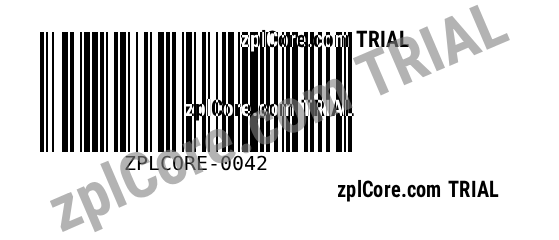

# Barcode to ZPL

Creates a ZPL label with a native Code 128 barcode (`^BC`) for the given data.

## Run

```sh
cd dotnet-csharp/barcode-to-zpl
dotnet run    # sample data
dotnet run -- "ABC-12345"
```

Results are written to the `output` folder.

## Expected output



## API

Label model: `Label` + `BarcodeItem`, `Label.ToZpl` - see the [documentation](https://zplcore.com/docs/) and the [API reference](https://zplcore.com/api-reference/).

Change `Symbology` for other barcodes (Code 39, EAN-13, DataMatrix, PDF417 ...).

Without a licence key the SDK runs in evaluation mode: rendered images carry a "zplCore.com TRIAL" watermark and generated ZPL contains small TRIAL fields. See the [main README](../../README.md#licence-key).
