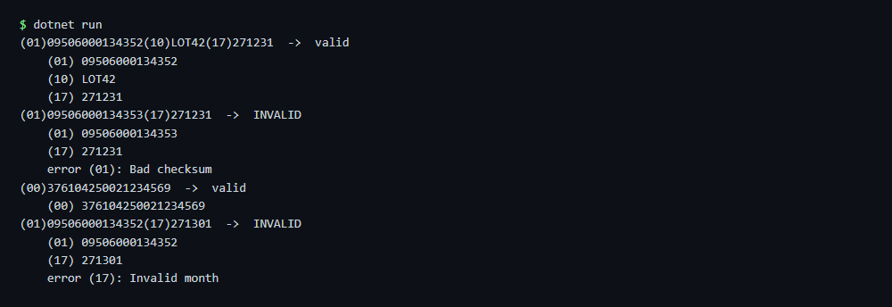

# Check barcode data

Checks GS1 barcode data, one code per line: AI structure, check digits, dates and lengths.

## Run

```sh
cd dotnet-csharp/check-barcode
dotnet run    # input: codes.txt
dotnet run -- my-codes.txt    # your own input
```

Results are written to the `output` folder.

## Expected output

```text
(01)09506000134352(10)LOT42(17)271231  ->  valid
    (01) 09506000134352
    (10) LOT42
    (17) 271231
(01)09506000134353(17)271231  ->  INVALID
    (01) 09506000134353
    (17) 271231
    error (01): Bad checksum
(00)376104250021234569  ->  valid
    (00) 376104250021234569
(01)09506000134352(17)271301  ->  INVALID
    (01) 09506000134352
    (17) 271301
    error (17): Invalid month
```



## API

`Gs1.Parse` - see the [documentation](https://zplcore.com/docs/) and the [API reference](https://zplcore.com/api-reference/).

This sample checks the barcode data. Reading barcodes from photos or scans is not part of this sample.

Without a licence key the SDK runs in evaluation mode: rendered images carry a "zplCore.com TRIAL" watermark and generated ZPL contains small TRIAL fields. See the [main README](../../README.md#licence-key).
