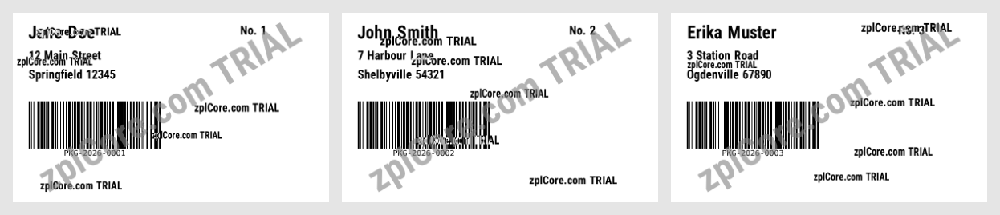

# Data binding

Binds a list of C# records to one label layout built in code: one label per record, written as one ZPL file and one
PDF (one page per label). The same works with any `IEnumerable<T>`, for example an EF Core query, a `DataTable` or
dictionaries.

## Run

```sh
cd dotnet-csharp/data-binding
dotnet run    # three sample records in Program.cs
```

Results are written to the `output` folder.

## Expected output

```text
3 records -> output/shipments.zpl (1800 characters), output/shipments.pdf (151997 bytes)
```



## API

`Label`, `TextItem`, `BarcodeItem`, `Label.For<T>()`, `LabelBinding<T>.ToZpl` and `LabelBinding<T>.RenderPdf` - see the [documentation](https://zplcore.com/docs/) and the [API reference](https://zplcore.com/api-reference/).

Without a licence key the SDK runs in evaluation mode: rendered images carry a "zplCore.com TRIAL" watermark and generated ZPL contains small TRIAL fields. See the [main README](../../README.md#licence-key).
