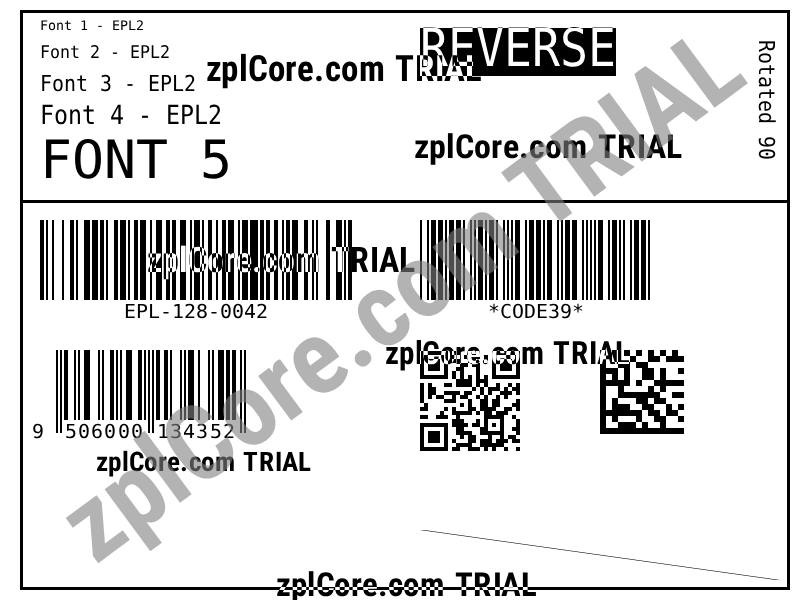

# EPL2 to ZPL

Converts an EPL2 label (text, barcodes, lines, boxes) into ZPL II.

## Run

```sh
cd dotnet-csharp/epl2-to-zpl
dotnet run    # input: label.epl
dotnet run -- my-label.epl    # your own input
```

Results are written to the `output` folder.

## Expected output



## API

`EplRenderer.ToZpl` - see the [documentation](https://zplcore.com/docs/) and the [API reference](https://zplcore.com/api-reference/).

Without a licence key the SDK runs in evaluation mode: rendered images carry a "zplCore.com TRIAL" watermark and generated ZPL contains small TRIAL fields. See the [main README](../../README.md#licence-key).
