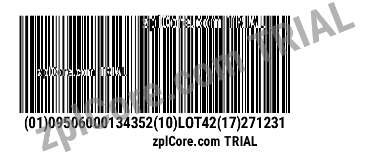

# GS1-128 to ZPL

Validates GS1 Application Identifiers (check digits, dates, lengths) and creates a ZPL label with a native GS1-128 barcode.

## Run

```sh
cd dotnet-csharp/gs1-ai-128-to-zpl
dotnet run    # sample data
dotnet run -- "(01)09506000134352(10)LOT42(17)271231"
```

Results are written to the `output` folder.

## Expected output



## API

`Gs1.Parse`, label model `BarcodeItem` with `Symbology.Gs1_128` - see the [documentation](https://zplcore.com/docs/) and the [API reference](https://zplcore.com/api-reference/).

Without a licence key the SDK runs in evaluation mode: rendered images carry a "zplCore.com TRIAL" watermark and generated ZPL contains small TRIAL fields. See the [main README](../../README.md#licence-key).
