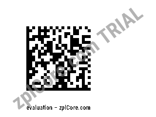

# GS1 DataMatrix to ZPL

Validates GS1 Application Identifiers and creates a ZPL label with a GS1 DataMatrix (FNC1 first) as `^GFA` graphic.

## Run

```sh
cd dotnet-csharp/gs1-ai-datamatrix-to-zpl
dotnet run    # sample data
dotnet run -- "(01)09506000134352(17)271231(10)LOT42(21)SN0001"
```

Results are written to the `output` folder.

## Expected output

```text
output/gs1-datamatrix.zpl: 609 characters
```



## API

`Gs1.Parse`, `Barcode` with `Symbology.Gs1DataMatrix`, `Barcode.ToZplGraphic` - see the [documentation](https://zplcore.com/docs/) and the [API reference](https://zplcore.com/api-reference/).

Without a licence key the SDK runs in evaluation mode: rendered images carry a "zplCore.com TRIAL" watermark and generated ZPL contains small TRIAL fields. See the [main README](../../README.md#licence-key).
