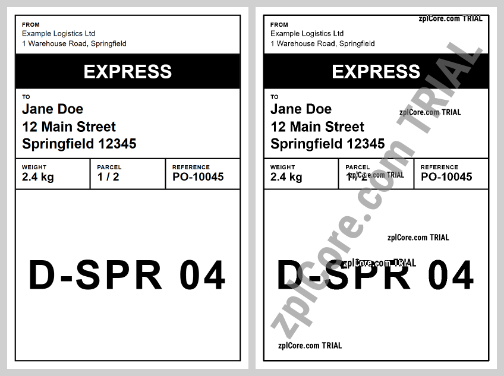

# HTML to ZPL

Renders an HTML label (`label.html`, CSS embedded, nothing loaded from the network) with headless Chromium
([Microsoft.Playwright](https://playwright.dev/dotnet/)) at exactly the label size and printer resolution:
4 x 6 in at 203 dpi = 812 x 1218 dots (viewport 384 x 576 CSS px, device scale factor 203/96). The image is converted
into a ZPL `^GFA` graphic, and the ZPL is rendered again with zplCore as a check.

## Prerequisites

Playwright needs its Chromium once per machine. Build first, then install it (PowerShell 7):

```sh
cd dotnet-csharp/html-to-zpl
dotnet build
pwsh bin/Debug/net10.0/playwright.ps1 install chromium
```

## Run

```sh
dotnet run    # input: label.html
dotnet run -- my-label.html    # your own input
```

Results are written to the `output` folder: `label-html.png` (the browser render), `label.zpl` and `label-zpl.png`
(the ZPL rendered by zplCore). Change the size and resolution at the top of `Program.cs`.

## Expected output

```text
output/label-html.png: 812 x 1218 px
output/label.zpl: 9194 characters
output/label-zpl.png: the ZPL rendered by zplCore
```

HTML render (left) and ZPL render (right):



## Graphic, not native ZPL

The whole label becomes one 1-bit graphic: no native ZPL text fields, no native barcodes, larger print data, and
barcodes drawn in HTML depend on the rasterisation. For labels with native fields use the label templates of the SDK
(see [json-template-to-zpl](../json-template-to-zpl/) and [data-binding](../data-binding/)) – text and barcodes then
stay printer commands.

## API

`ZplGraphicEncoder.ToZpl` and `ZplRenderer.ProcessCommands` - see the [documentation](https://zplcore.com/docs/) and the [API reference](https://zplcore.com/api-reference/).

Without a licence key the SDK runs in evaluation mode: rendered images carry a "zplCore.com TRIAL" watermark and generated ZPL contains small TRIAL fields. See the [main README](../../README.md#licence-key).
