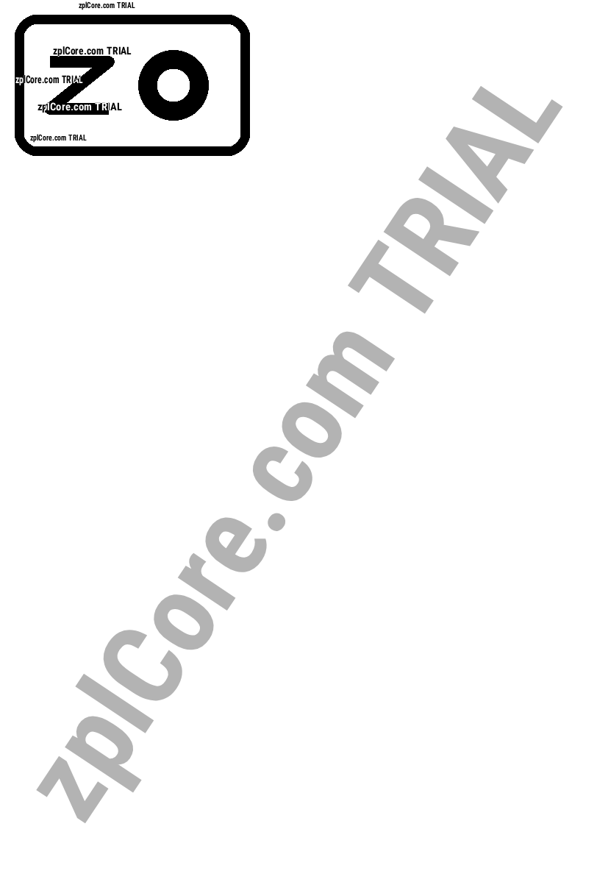

# Image to ZPL

Converts a PNG, JPG, BMP or GIF image into a ZPL label with a compressed 1-bit `^GFA` graphic.

## Run

```sh
cd dotnet-csharp/image-to-zpl
dotnet run    # input: logo.png
dotnet run -- my-logo.png    # your own input
```

Results are written to the `output` folder.

## Expected output

```text
output/logo.zpl: 320 x 192 dots, 1341 characters
```



## API

`ZplGraphicEncoder.ToZpl` - see the [documentation](https://zplcore.com/docs/) and the [API reference](https://zplcore.com/api-reference/).

Without a licence key the SDK runs in evaluation mode: rendered images carry a "zplCore.com TRIAL" watermark and generated ZPL contains small TRIAL fields. See the [main README](../../README.md#licence-key).
