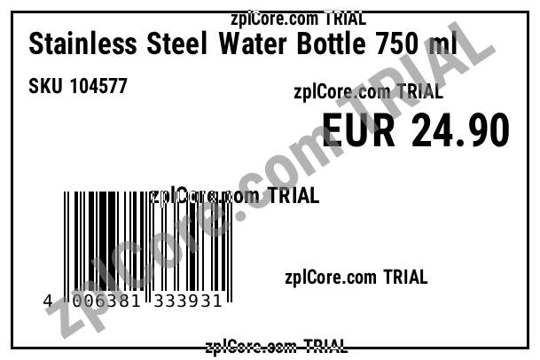

# JSON template to ZPL

Fills a label template (`product-label.json`, the zplCore label format in millimetres) with one record
(`record.json`) and writes the ZPL and a PNG preview. Fields are bound by name (`dataField`) or computed with an
expression (`"EUR " + Format([Price], "0.00")`).

## Run

```sh
cd dotnet-csharp/json-template-to-zpl
dotnet run    # input: product-label.json record.json
dotnet run -- my-template.json my-record.json    # your own input
```

Results are written to the `output` folder.

## Expected output

```text
output/label.zpl: 625 characters
output/label.png: 25394 bytes
```



## API

`Label.FromJson`, `Label.For<T>()`, `LabelBinding<T>.ToZpl` and `LabelBinding<T>.Render` - see the [documentation](https://zplcore.com/docs/) and the [API reference](https://zplcore.com/api-reference/).

Without a licence key the SDK runs in evaluation mode: rendered images carry a "zplCore.com TRIAL" watermark and generated ZPL contains small TRIAL fields. See the [main README](../../README.md#licence-key).
