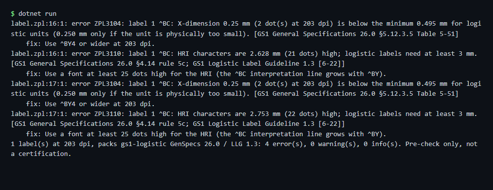

# Label compliance check

Checks a ZPL label against the GS1 logistic label rules (X-dimension, bar height, quiet zones, human readable text, AI structure) on the rendered geometry and writes the report as text, JSON and SARIF. The sample label uses a too small X-dimension on purpose. A pre-check, not a certification.

## Run

```sh
cd dotnet-csharp/label-compliance-check
dotnet run    # input: label.zpl
dotnet run -- my-label.zpl    # your own input
```

Results are written to the `output` folder.

## Expected output

```text
label.zpl:16:1: error ZPL3104: label 1 ^BC: X-dimension 0.25 mm (2 dot(s) at 203 dpi) is below the minimum 0.495 mm for logistic units (0.250 mm only if the unit is physically too small). [GS1 General Specifications 26.0 §5.12.3.5 Table 5-51]
    fix: Use ^BY4 or wider at 203 dpi.
label.zpl:16:1: error ZPL3110: label 1 ^BC: HRI characters are 2.628 mm (21 dots) high; logistic labels need at least 3 mm. [GS1 General Specifications 26.0 §4.14 rule 5c; GS1 Logistic Label Guideline 1.3 [6-22]]
    fix: Use a font at least 25 dots high for the HRI (the ^BC interpretation line grows with ^BY).
label.zpl:17:1: error ZPL3104: label 1 ^BC: X-dimension 0.25 mm (2 dot(s) at 203 dpi) is below the minimum 0.495 mm for logistic units (0.250 mm only if the unit is physically too small). [GS1 General Specifications 26.0 §5.12.3.5 Table 5-51]
    fix: Use ^BY4 or wider at 203 dpi.
label.zpl:17:1: error ZPL3110: label 1 ^BC: HRI characters are 2.753 mm (22 dots) high; logistic labels need at least 3 mm. [GS1 General Specifications 26.0 §4.14 rule 5c; GS1 Logistic Label Guideline 1.3 [6-22]]
    fix: Use a font at least 25 dots high for the HRI (the ^BC interpretation line grows with ^BY).
1 label(s) at 203 dpi, packs gs1-logistic GenSpecs 26.0 / LLG 1.3: 4 error(s), 0 warning(s), 0 info(s). Pre-check only, not a certification.
```



## API

`ZplCompliance.Check` with `CompliancePacks.Gs1LogisticLabel` - see the [documentation](https://zplcore.com/docs/) and the [API reference](https://zplcore.com/api-reference/).

Other packs: `Sunrise2027`, `AmazonFba`, `Ups`, `Udi`, `FedEx` (combine with `|`).

Without a licence key the SDK runs in evaluation mode: rendered images carry a "zplCore.com TRIAL" watermark and generated ZPL contains small TRIAL fields. See the [main README](../../README.md#licence-key).
