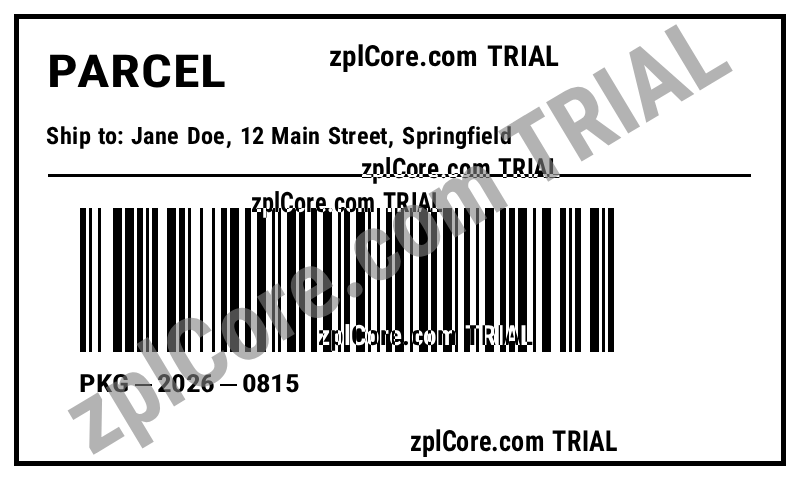

# PDF to native ZPL

Converts a PDF label into native ZPL: text as `^A` fields, barcodes as native `^B` commands (decoded, regenerated and verified), lines and boxes as `^GB`, and `^GF` only for the rest. Reports the fidelity against the PDF and the size compared with a plain `^GF` image.

## Run

```sh
cd dotnet-csharp/pdf-to-native-zpl
dotnet run    # input: label.pdf
dotnet run -- my-label.pdf    # your own input
```

Results are written to the `output` folder.

## Expected output

```text
output/label.zpl: 612 bytes (as a full ^GF graphic: 2416 bytes)
Fidelity against the PDF: 98.5 %
```



## API

`VectorLift.Convert` (NuGet package `ZplCore.VectorLift`) - see the [documentation](https://zplcore.com/docs/) and the [API reference](https://zplcore.com/api-reference/).

Without a licence key the SDK runs in evaluation mode: rendered images carry a "zplCore.com TRIAL" watermark and generated ZPL contains small TRIAL fields. See the [main README](../../README.md#licence-key).
