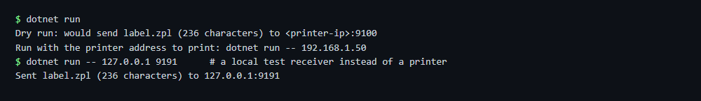

# Print to a network printer

Sends a ZPL file to a network label printer over raw TCP (port 9100). Without a printer address the sample runs as a
dry run and only shows what would be sent, so it works without a printer.

## Run

```sh
cd dotnet-csharp/print-to-network-printer
dotnet run                                   # dry run
dotnet run -- 192.168.1.50                   # print label.zpl on the printer at 192.168.1.50:9100
dotnet run -- 192.168.1.50 9100 my-label.zpl # other port or file
```

## Expected output



The second command in the screenshot sends to a local test receiver instead of a printer; it received the file
byte for byte. On a printer, `label.zpl` prints this label:


## API

`ZplPrinterClient.SendAsync` (namespace `ZplCore.Printing`) - see the [documentation](https://zplcore.com/docs/) and the [API reference](https://zplcore.com/api-reference/).
`ZplPrinterClient.GetStatusAsync` reads the printer status (`~HS`): paper out, head open, paused.

Without a licence key the SDK runs in evaluation mode: rendered images carry a "zplCore.com TRIAL" watermark and generated ZPL contains small TRIAL fields. See the [main README](../../README.md#licence-key).
