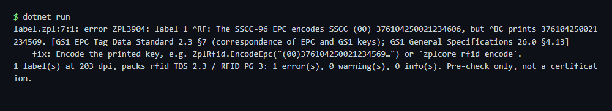

# RFID check

Checks that the EPC written to the RFID tag (`^RF`) matches the barcodes printed on the same label. The sample label has a mismatch on purpose.

## Run

```sh
cd dotnet-csharp/rfid-check
dotnet run    # input: label.zpl
dotnet run -- my-rfid-label.zpl    # your own input
```

Results are written to the `output` folder.

## Expected output

```text
label.zpl:7:1: error ZPL3904: label 1 ^RF: The SSCC-96 EPC encodes SSCC (00) 376104250021234606, but ^BC prints 376104250021234569. [GS1 EPC Tag Data Standard 2.3 §7 (correspondence of EPC and GS1 keys); GS1 General Specifications 26.0 §4.13]
    fix: Encode the printed key, e.g. ZplRfid.EncodeEpc("(00)376104250021234569…") or 'zplcore rfid encode'.
1 label(s) at 203 dpi, packs rfid TDS 2.3 / RFID PG 3: 1 error(s), 0 warning(s), 0 info(s). Pre-check only, not a certification.
```



## API

`ZplRfid.Check` - see the [documentation](https://zplcore.com/docs/) and the [API reference](https://zplcore.com/api-reference/).

Without a licence key the SDK runs in evaluation mode: rendered images carry a "zplCore.com TRIAL" watermark and generated ZPL contains small TRIAL fields. See the [main README](../../README.md#licence-key).
