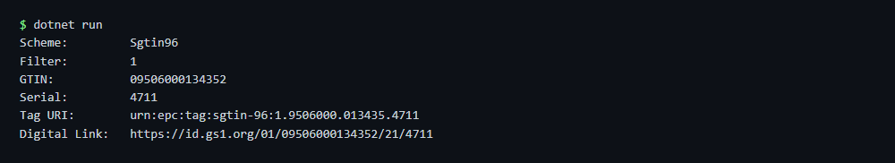

# RFID decode

Decodes an EPC read from an RFID tag (hex) into its GS1 keys, Tag URI and GS1 Digital Link.

## Run

```sh
cd dotnet-csharp/rfid-decode
dotnet run    # sample data
dotnet run -- 30364433400D1EC000001267
```

Results are written to the `output` folder.

## Expected output

```text
Scheme:         Sgtin96
Filter:         1
GTIN:           09506000134352
Serial:         4711
Tag URI:        urn:epc:tag:sgtin-96:1.9506000.013435.4711
Digital Link:   https://id.gs1.org/01/09506000134352/21/4711
```



## API

`ZplRfid.DecodeEpc` - see the [documentation](https://zplcore.com/docs/) and the [API reference](https://zplcore.com/api-reference/).

Without a licence key the SDK runs in evaluation mode: rendered images carry a "zplCore.com TRIAL" watermark and generated ZPL contains small TRIAL fields. See the [main README](../../README.md#licence-key).
