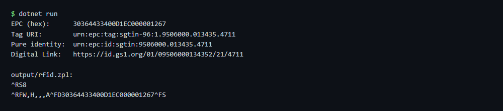

# RFID encode

Encodes a GTIN and serial number as SGTIN-96 EPC (GS1 EPC Tag Data Standard) and writes the ZPL commands that program the tag.

## Run

```sh
cd dotnet-csharp/rfid-encode
dotnet run    # sample data
dotnet run -- 09506000134352 4711 7
```

Results are written to the `output` folder.

## Expected output

```text
EPC (hex):      30364433400D1EC000001267
Tag URI:        urn:epc:tag:sgtin-96:1.9506000.013435.4711
Pure identity:  urn:epc:id:sgtin:9506000.013435.4711
Digital Link:   https://id.gs1.org/01/09506000134352/21/4711

output/rfid.zpl:
^RS8
^RFW,H,,,A^FD30364433400D1EC000001267^FS
```



## API

`ZplRfid.EncodeSgtin` and `ZplRfid.BuildCommands` - see the [documentation](https://zplcore.com/docs/) and the [API reference](https://zplcore.com/api-reference/).

Arguments: GTIN, serial number, length of the GS1 company prefix.

Without a licence key the SDK runs in evaluation mode: rendered images carry a "zplCore.com TRIAL" watermark and generated ZPL contains small TRIAL fields. See the [main README](../../README.md#licence-key).
