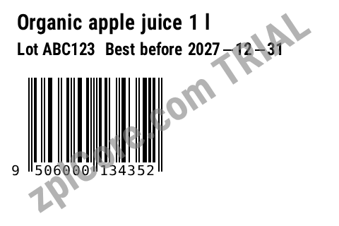
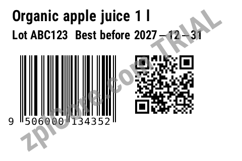

# Sunrise 2027 migration

Adds a QR Code with a GS1 Digital Link URI next to the EAN/UPC of an existing ZPL label (in free space, with quiet zones) and runs the Sunrise 2027 pre-check. A migration assistant, not a certification.

## Run

```sh
cd dotnet-csharp/sunrise-2027-migration
dotnet run    # input: label.zpl
dotnet run -- my-label.zpl    # your own input
```

Results are written to the `output` folder.

## Expected output

```text
label: migrated
Sunrise 2027 errors after migration: 0
output/label-migrated.zpl written
```





## API

`ZplGs1Migration.Migrate` - see the [documentation](https://zplcore.com/docs/) and the [API reference](https://zplcore.com/api-reference/).

Without a licence key the SDK runs in evaluation mode: rendered images carry a "zplCore.com TRIAL" watermark and generated ZPL contains small TRIAL fields. See the [main README](../../README.md#licence-key).
