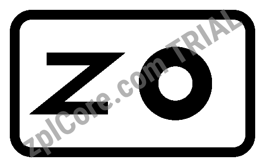

# SVG to ZPL

Converts an SVG drawing into a ZPL label with a `^GFA` graphic at the given height in dots.

## Run

```sh
cd dotnet-csharp/svg-to-zpl
dotnet run    # input: logo.svg
dotnet run -- my-logo.svg 400    # your own input
```

Results are written to the `output` folder.

## Expected output

```text
output/logo.zpl: 500 x 300 dots, 4032 characters
```



## API

`SvgImage.ToGraphicField` - see the [documentation](https://zplcore.com/docs/) and the [API reference](https://zplcore.com/api-reference/).

Without a licence key the SDK runs in evaluation mode: rendered images carry a "zplCore.com TRIAL" watermark and generated ZPL contains small TRIAL fields. See the [main README](../../README.md#licence-key).
