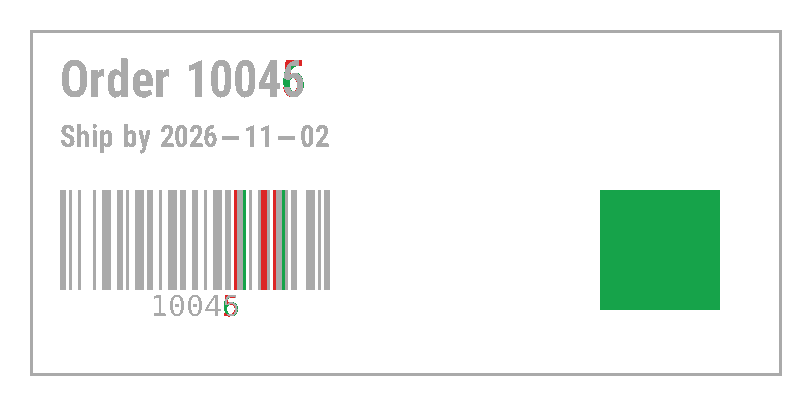

# ZPL diff

Compares two ZPL versions pixel by pixel and line by line and writes an overlay image: grey = unchanged, red = only in the first file, green = only in the second file.

## Run

```sh
cd dotnet-csharp/zpl-diff
dotnet run    # input: before.zpl after.zpl
dotnet run -- old.zpl new.zpl    # your own input
```

Results are written to the `output` folder.

## Expected output

```text
Pixel identical: False, changed pixels: 16425
Lines added: 4, lines removed: 2
-     ^FDOrder 10045^FS
+     ^FDOrder 10046^FS
-     ^FD10045^FS
+     ^FD10046^FS
+   ^FO600,190
+     ^GB120,120,60^FS
output/diff-1.png: 4 changed region(s)
```



## API

`ZplDiff.Compare` - see the [documentation](https://zplcore.com/docs/) and the [API reference](https://zplcore.com/api-reference/).

Without a licence key the SDK runs in evaluation mode: rendered images carry a "zplCore.com TRIAL" watermark and generated ZPL contains small TRIAL fields. See the [main README](../../README.md#licence-key).
