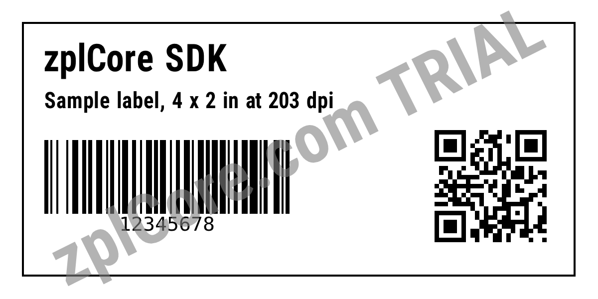

# ZPL DPI converter

Converts ZPL written for one printer resolution to another (default 203 dpi to 300 dpi): positions, fonts, barcodes, boxes and `^GF` graphics are recalculated.

## Run

```sh
cd dotnet-csharp/zpl-dpi-converter
dotnet run    # input: label.zpl
dotnet run -- my-label.zpl 203 600    # your own input
```

Results are written to the `output` folder.

## Expected output

```text
output/label-300dpi.zpl:
^XA^CI28^PW1200^LL600^FO44,44^GB1111,511,4^FS
^FO89,89^A0N,74,74^FDzplCore SDK^FS
^FO89,185^A0N,44,44^FDSample label, 4 x 2 in at 203 dpi^FS
^FO89,281^BY4^BCN,148,Y,N,N^FD12345678^FS
^FO872,251^BQN,2,9^FDQA,https://zplcore.com^FS
^XZ
```



## API

`ZplRescaler.Rescale` - see the [documentation](https://zplcore.com/docs/) and the [API reference](https://zplcore.com/api-reference/).

Without a licence key the SDK runs in evaluation mode: rendered images carry a "zplCore.com TRIAL" watermark and generated ZPL contains small TRIAL fields. See the [main README](../../README.md#licence-key).
