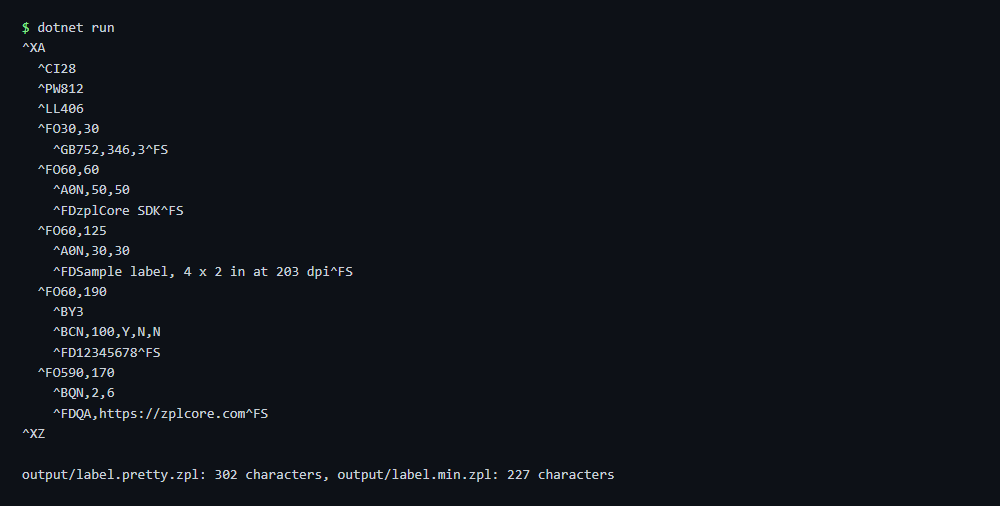

# ZPL formatter

Pretty-prints a ZPL file (one command per line, field blocks indented) and writes a minified copy. Field data is copied byte for byte.

## Run

```sh
cd dotnet-csharp/zpl-formatter
dotnet run    # input: label.zpl
dotnet run -- my-label.zpl    # your own input
```

Results are written to the `output` folder.

## Expected output

```text
^XA
  ^CI28
  ^PW812
  ^LL406
  ^FO30,30
    ^GB752,346,3^FS
  ^FO60,60
    ^A0N,50,50
    ^FDzplCore SDK^FS
  ^FO60,125
    ^A0N,30,30
    ^FDSample label, 4 x 2 in at 203 dpi^FS
  ^FO60,190
    ^BY3
    ^BCN,100,Y,N,N
    ^FD12345678^FS
  ^FO590,170
    ^BQN,2,6
    ^FDQA,https://zplcore.com^FS
^XZ

output/label.pretty.zpl: 302 characters, output/label.min.zpl: 227 characters
```



## API

`ZplFormatter.Format` and `ZplFormatter.Minify` - see the [documentation](https://zplcore.com/docs/) and the [API reference](https://zplcore.com/api-reference/).

Without a licence key the SDK runs in evaluation mode: rendered images carry a "zplCore.com TRIAL" watermark and generated ZPL contains small TRIAL fields. See the [main README](../../README.md#licence-key).
