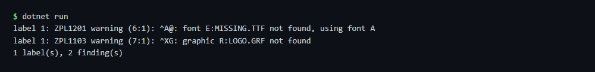

# ZPL linter

Renders a ZPL file the way a printer would and lists everything a printer would skip or misread, with a stable code, severity and line:column. The exit code is 1 when there are findings, so it can run in a build pipeline.

## Run

```sh
cd dotnet-csharp/zpl-linter
dotnet run    # input: label.zpl
dotnet run -- my-label.zpl    # your own input
```

Results are written to the `output` folder.

## Expected output

```text
label 1: ZPL1201 warning (6:1): ^A@: font E:MISSING.TTF not found, using font A
label 1: ZPL1103 warning (7:1): ^XG: graphic R:LOGO.GRF not found
1 label(s), 2 finding(s)
```



## API

`ZplRenderer.Render` and `ZplRenderResult.Diagnostics` - see the [documentation](https://zplcore.com/docs/) and the [API reference](https://zplcore.com/api-reference/).

All diagnostic codes are described in the [documentation](https://zplcore.com/docs/#diagnostics).

Without a licence key the SDK runs in evaluation mode: rendered images carry a "zplCore.com TRIAL" watermark and generated ZPL contains small TRIAL fields. See the [main README](../../README.md#licence-key).
