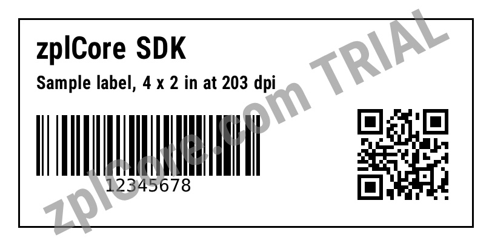

# ZPL to JPG

Renders every label of a ZPL file to a JPG image.

## Run

```sh
cd dotnet-csharp/zpl-to-jpg
dotnet run    # input: label.zpl
dotnet run -- my-labels.zpl    # your own input
```

Results are written to the `output` folder.

## Expected output

```text
output/label-1.jpg: 63201 bytes
```



## API

`ZplRenderer.ProcessCommands` with `ZplOutputFormat.Jpeg` - see the [documentation](https://zplcore.com/docs/) and the [API reference](https://zplcore.com/api-reference/).

Without a licence key the SDK runs in evaluation mode: rendered images carry a "zplCore.com TRIAL" watermark and generated ZPL contains small TRIAL fields. See the [main README](../../README.md#licence-key).
