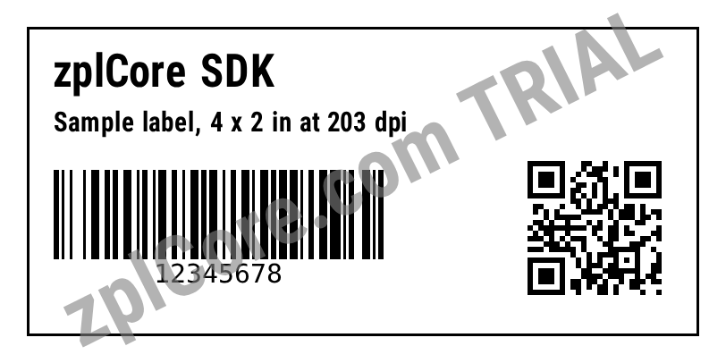

# ZPL to SVG

Renders every label of a ZPL file to a vector SVG: text as glyph outlines, barcodes as rectangles, sharp at any zoom.

## Run

```sh
cd dotnet-csharp/zpl-to-svg
dotnet run    # input: label.zpl
dotnet run -- my-labels.zpl    # your own input
```

Results are written to the `output` folder.

## Expected output

```text
output/label-1.svg: 52982 characters
```



## API

`ZplRenderer.RenderSvg` - see the [documentation](https://zplcore.com/docs/) and the [API reference](https://zplcore.com/api-reference/).

Without a licence key the SDK runs in evaluation mode: rendered images carry a "zplCore.com TRIAL" watermark and generated ZPL contains small TRIAL fields. See the [main README](../../README.md#licence-key).
